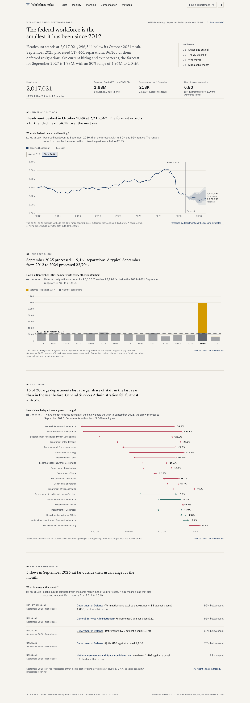

# Workforce Atlas

An independent analysis of the U.S. federal civilian workforce from OPM's Federal Workforce Data, December 2011 to
September 2026: who works for the government, who is leaving, what they are paid, and where headcount is heading.
It is not affiliated with, or endorsed by, the U.S. Office of Personnel Management (OPM).

**Live site:** <https://workforce-atlas.pages.dev>



## What it does

- **Reconciles every OPM file.** A DuckDB pipeline fetches each monthly file, checks it against a data contract and
  cubes it. Months OPM itself reports as incomplete are read from its release notes, reviewed by a person and kept
  out of every model, so a reporting gap is never shown as a workforce collapse.
- **Forecasts headcount** for the government and its 18 largest departments, choosing among four methods on
  forecasts made for 2022 and earlier and testing on 2023–2024: 1.7% error a year ahead government-wide, 2.9% for
  departments. Ranges come from the method's own past errors and widen after a run of misses (adaptive conformal
  inference).
- **Models voluntary exits** for groups of employees with gradient boosting, validated year by year, with each
  year's level set by the private-sector quit rate (BLS JOLTS). On held-out years its error (Poisson deviance)
  is 87.5% below a department-average baseline. FY2025 voluntary exits ran 1.92 times the expected level, or 1.21 times without deferred resignations.
- **Flags unusual months** across 149 hiring and exit series (0.69% flag rate on held-out 2022–2024).
- **Publishes a static site** with custom D3 charts, a what-if simulator that reproduces the forecast exactly, a
  printable monthly brief and 131 static pages, checked for accessibility (WCAG 2.2 AA) in CI.

Every figure carries its kind: **observed** (reported by OPM), **derived** (arithmetic on observed data) or
**modeled** (with its interval and how it was tested). Methods and limits are on the site's Methods page and in
[docs/05-models.md](docs/05-models.md).

## How it fits together

```
OPM FWD API ─► pipeline.build ─► data/warehouse (Parquet cubes)
OPM release notes ─► pipeline.notices ─┐
BLS JOLTS API ─► pipeline.labour ──────┤
                                       ▼
                        pipeline.publish ─► models.run ─► pipeline.web ─► web/ (Next.js static export) ─► Cloudflare Pages
```

Details, including why each part exists: [docs/ARCHITECTURE.md](docs/ARCHITECTURE.md).

## Quick start

Requires Python 3.14 and the Node version in `.nvmrc`. Full guide: [docs/REPRODUCING.md](docs/REPRODUCING.md).

```bash
python3.14 -m venv .venv && .venv/bin/pip install --require-hashes -r requirements.lock
scripts/fetch_data.sh                 # latest published data from the private release (needs gh auth)
.venv/bin/python -m pipeline.web      # writes web/data/
cd web && npm ci && npm run build     # writes web/out/
npm run pdf && npm run test:e2e       # brief PDF, browser and accessibility checks
cd .. && .venv/bin/python -m pytest -q && scripts/check_public.sh web/out
```

## Repository layout

```
pipeline/   fetch, validate, cube, publish, OPM notices, BLS quit rate, web export
models/     forecast, anomaly, retention, exit model, runner
sql/        cube and publish queries
ref/        reference tables and the reviewed data notices
tests/      pipeline contract and model tests
web/        Next.js site (app/, components/, lib/, e2e/)
scripts/    data release packaging, public-build check
docs/       architecture, deployment, reproduction, models, audit reports
data/       generated; never in git (ships as a private release asset)
```

## Limitations

- Government-wide forecast ranges still hold too few outcomes (53% of 2023–2024 against a nominal 80%): misses come
  one year at a time, and two test years cannot size the next shock.
- The exit model ranks groups well but can miss a whole year's total by up to 14%.
- OPM revises months and reports gaps late; reviewed notices in `ref/data_notices.csv` are the control.
- Pay is observed where reported and otherwise derived from the GS table, so it is not a payroll record.

## Data sources

- OPM Federal Workforce Data, <https://data.opm.gov>, and OPM release notes.
- BLS Job Openings and Labor Turnover Survey, private-sector quits rate (`JTS100000000000000QUR`), <https://www.bls.gov/jlt/>.

Both are U.S. government works, not subject to copyright in the United States (17 U.S.C. section 105). The analysis
and its numbers are this project's own, not OPM's or BLS's.

## Rights

All rights reserved. This repository is private, and no license is granted to use, copy, modify or distribute its
code. The public website may be viewed freely.
