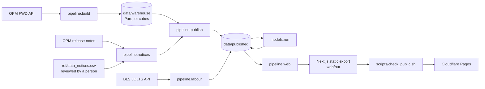

# Workforce Atlas: architecture

The design rests on one decision: **everything is computed ahead of time and the website is plain files.** There is
no server, database or API at request time, so the public site has nothing to attack, nothing to scale and nothing
to pay for beyond static hosting. The cost is that data changes only when the monthly pipeline runs, which matches
OPM's monthly release.

## Flow

| Stage | Code | Output | Why it exists |
|---|---|---|---|
| Fetch and cube | `pipeline/build.py`, `pipeline/opm.py`, `sql/cube_*.sql` | `data/warehouse/` Parquet, one file per cube and month | Each OPM file is validated against a contract (`pipeline/validate.py`) and only re-versioned months are rebuilt |
| Data notices | `pipeline/notices.py`, `ref/data_notices.csv` | `data_notices.json` | OPM reports missing submissions only in release notes; without this, gaps read as collapses |
| Labour market | `pipeline/labour.py` | `labour_quits.csv` | Sets the exit model's yearly level; a failed fetch keeps the last file |
| Publish | `pipeline/publish.py`, `sql/publish_*.sql` | `data/published/` tables, facts, quality profile, manifest of source files | One reviewed set of tables every model and page reads |
| Models | `models/` | `data/published/models/*.json` | Forecast, unusual months, retention, exit model; each chosen on earlier years and tested on later ones (`docs/05-models.md`) |
| Web export | `pipeline/web.py` | `web/data/` | Strict JSON the site imports at build time |
| Site | `web/` (Next.js 16, React, D3, Tailwind) | `web/out/`, 131 static pages and a PDF brief | Pages are rendered at build; the browser only runs charts, search and the simulator |

## Where things live

| Thing | Where | Public? |
|---|---|---|
| Source code | Private GitHub repository | No |
| Warehouse cache (~295 MB) | Release asset `warehouse` in the private repo | No |
| Published data (~9.5 MB) | Release assets `published-latest`, `published-YYYY-MM-DD` in the private repo | No |
| Website | Cloudflare Pages, uploaded as built files | Yes |

The website necessarily contains the aggregated figures it shows (JSON embedded in the pages) and the compiled,
minified JavaScript for its interactive parts. It contains no source maps, raw data files, credentials or local
paths; `scripts/check_public.sh` fails the deploy if any appear.

## Automation

- **`ci.yml`** on every push and pull request: pytest, `pip-audit`, ESLint, TypeScript, unit tests, then, when a data
  release exists, the build, PDF, browser and accessibility checks, and the public-build check.
- **`pipeline.yml`** on the 8th of each month and by hand: refresh → models → site → checks → data release, then
  opens an issue if OPM notices need review or the run failed. The `deploy` job runs only when the owner has set
  `DEPLOY_ENABLED`, uses the `production` environment, and uploads `web/out` to Cloudflare Pages.
- Actions are pinned to commit SHAs, Python packages are installed with `--require-hashes`, and jobs get the
  narrowest token permissions they need.

## Security posture

- Static files only: no server code, forms, accounts or cookies.
- Response headers in `web/public/_headers`: a Content Security Policy that allows only the site's own origin, plus
  `nosniff`, a strict referrer policy, HSTS and `frame-ancestors 'none'`. The browser checks run under the same
  headers (`web/e2e/serve.mjs`), so a change that breaks the policy fails CI.
- One secret: `CLOUDFLARE_API_TOKEN`, scoped to Cloudflare Pages edit, stored as a GitHub Actions secret in the
  `production` environment. Nothing else needs a key: OPM and BLS are read through keyless public APIs.
